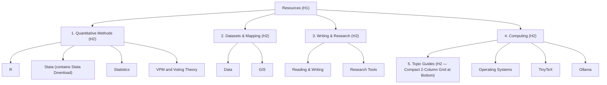

# Redesign Layout for Resources Webpage (`resources/index.qmd`)

## Goal Description

Redesign [`resources/index.qmd`](file:///Users/lpaul/gitrepos/pmlove3.github.io/resources/index.qmd) and the guide listing styles in [`styles.css`](file:///Users/lpaul/gitrepos/pmlove3.github.io/styles.css) to address three layout and information-architecture problems:

1. **Guides dominate the top of the page:** The 12-item Quarto listing (`#listing-guides`) is moved to the bottom under `## Topic Guides`, sorted by `["order", "title"]` (placing *Learning R* and *Learning Stata* side-by-side in row 1), and styled as a compact 2-column grid (also applied to the 11-item guide listing on [`resources/r.qmd`](file:///Users/lpaul/gitrepos/pmlove3.github.io/resources/r.qmd)).
2. **Duplicated heading and subitem link names:** Top-level headings are renamed to concise, non-duplicative categories (`Quantitative Methods`, `Datasets & Mapping`, `Writing & Research`, `Computing`), while link labels match exact target page H1 titles paired with a concise 8–12 word one-line description.
3. **Redundant subpage links (`Stata Download` and `LLM`):** `Stata Download` is removed from `resources/index.qmd` (since it already lives under `## NYUAD Software Downloads` inside [`resources/stata.qmd`](file:///Users/lpaul/gitrepos/pmlove3.github.io/resources/stata.qmd)), and `LLM` + `Ollama` are consolidated into a single `Ollama` entry on `resources/index.qmd` (keeping [`resources/llm.qmd`](file:///Users/lpaul/gitrepos/pmlove3.github.io/resources/llm.qmd) intact for course syllabus links).

---

## Proposed Layout Overview



---

## Proposed Changes

### Resources Index Page

#### [MODIFY] [index.qmd](file:///Users/lpaul/gitrepos/pmlove3.github.io/resources/index.qmd)

- Move the Quarto listing to the bottom under `## Topic Guides` and change `sort: "title"` to `sort: ["order", "title"]`.
- Organize top-level pages under four concise category headings (`Quantitative Methods`, `Datasets & Mapping`, `Writing & Research`, `Computing`).
- Use exact target page titles as links with concise 8–12 word annotations.
- Remove `Stata Download` and `LLM` as peer links on `resources/index.qmd`.

```markdown
---
title: "Resources"
description: "Guides and links for students and researchers: R, Stata, statistics, data and GIS, writing tools, and research software."
date: "2026-10-31"
listing:
  id: guides
  contents:
    - "r/*.qmd"
    - "stata/*.qmd"
  type: default
  fields: [title, description]
  sort:
    - "order"
    - "title"
  max-description-length: 200
---

## Quantitative Methods

* [R](../resources/r.html) — Installation, cloud computing options, Quarto publishing setup, and R topic guides.
* [Stata](../resources/stata.html) — NYUAD software downloads, workflow habits, operator reference, and learning guides.
* [Statistics](../resources/statistics.html) — Open textbooks, probability primers, z-score tables, and regression interpretation notes.
* [VPM and Voting Theory](../resources/vpm-and-voting-theory.html) — Ranked-choice voting, Condorcet, approval voting, STV, and power-index calculators.

## Datasets & Mapping

* [Data](../resources/data.html) — Cross-national surveys, political and economic indicators, archives, and geospatial collections.
* [GIS](../resources/gis.html) — QGIS installation, tutorials, video playlists, plugins, and project-sharing instructions.

## Writing & Research

* [Reading & Writing](../resources/reading-writing.html) — Guides for political science essays, policy memos, op-eds, and cables.
* [Research Tools](../resources/research-tools.html) — Reference management with Zotero, note-taking apps, editors, and macOS utilities.

## Computing

* [Operating Systems](../resources/operating-systems.html) — macOS, Homebrew package management, Windows training, and coding primers.
* [TinyTeX](../resources/tinytex.html) — Lightweight LaTeX distribution for rendering R Markdown and Quarto PDFs.
* [Ollama](../resources/ollama.html) — Step-by-step installation for running local large language models on macOS and Windows.

## Topic Guides

Focused guides on R and Stata packages, workflows, and methods (also listed on the [R](../resources/r.html) and [Stata](../resources/stata.html) pages):

::: {#guides}
:::
```

---

### Stylesheet

#### [MODIFY] [styles.css](file:///Users/lpaul/gitrepos/pmlove3.github.io/styles.css)

- Update `[id^="listing-"][id$="-guides"]` in [`styles.css`](file:///Users/lpaul/gitrepos/pmlove3.github.io/styles.css#L196-L227) so multi-item guide listings (`#listing-guides` on `resources/index.html` and `#listing-r-guides` on `resources/r.html`) display in a responsive 2-column CSS grid with compact spacing.

```diff
 /* ---- Guide cards on resource hubs (listing ids ending in -guides) ---- */
 [id^="listing-"][id$="-guides"] {
   margin-right: 0;
 }
+[id^="listing-"][id$="-guides"] .list {
+  display: grid;
+  grid-template-columns: repeat(auto-fill, minmax(280px, 1fr));
+  gap: 0.75rem 1.5rem;
+}
 [id^="listing-"][id$="-guides"] .quarto-post {
   display: block;
-  margin-bottom: 0.5rem;
+  margin-bottom: 0;
   padding: 0.25rem 0 0.25rem 1rem;
   background: transparent;
   border: none;
   border-left: 4px solid var(--accent-teal, #16636b);
   border-radius: 0;
   box-shadow: none;
 }
 [id^="listing-"][id$="-guides"] .quarto-post .metadata {
   display: none;
 }
 [id^="listing-"][id$="-guides"] .listing-title {
+  font-size: 1.05rem;
   margin-bottom: 0.25rem;
 }
 [id^="listing-"][id$="-guides"] .listing-title a {
   color: var(--accent-terracotta, #a8471f);
   text-decoration: underline;
   text-underline-offset: 0.2em;
 }
+[id^="listing-"][id$="-guides"] .listing-description {
+  font-size: 0.92rem;
+}
 [id^="listing-"][id$="-guides"] .listing-description a {
   color: inherit;
 }
```

---

## Verification Plan

### Automated Tests
1. Render the Quarto site:
   ```bash
   quarto render
   ```
2. Run the Python test suite:
   ```bash
   python3 -m unittest discover -s tests
   ```
3. Run the internal link checker:
   ```bash
   python3 _plans/tools/check_internal_links.py
   ```
4. Run the accessibility audit:
   ```bash
   npm run audit
   ```

### Manual Verification
- Inspect `docs/resources/index.html` and `docs/resources/r.html` to confirm the new hierarchy, link annotations, sorting (`Learning R` and `Learning Stata` first), and 2-column responsive grid.
